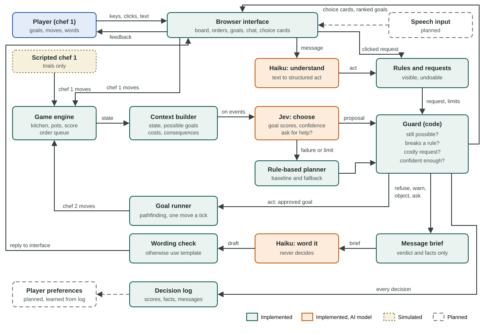

# Adaptive Goal Planning for Human-AI Collaboration in Cooperative Games

README prose word count: about 680

An architecture for an AI teammate that plans, reprioritises, disagrees and explains itself. It is demonstrated on a
benchmark: a two-player cooperative kitchen.

## Project status

| Part | Status |
|---|---|
| Two kitchens, order queue, human control, pathfinding | Implemented |
| Rule and Jev planners, ranked goals, asking when unsure | Implemented |
| Chat, refusals, warnings, objections, lasting rules, help requests, "Why?" | Implemented |
| Trials against baselines, with a scripted partner | Simulated |
| LLM goal generation, speech input, learned preferences, user study | Planned |

Known limits: Jev is not repeatable, the objection thresholds are judgements, and the check on Haiku's wording
catches wrong numbers, ingredients and causal claims but not bad logic.



## Technology stack

| Technology | Use |
|---|---|
| Python 3.12, numpy, standard-library web server | Game, planners, local server |
| HTML canvas and JavaScript | Interface |
| [Overcooked-AI](https://github.com/HumanCompatibleAI/overcooked_ai) game logic (MIT, commit `739950a`) | Engine, in `src/overcooked_ai_py` |
| Jev 1.14 through OpenRouter | Scores the possible goals; never writes text |
| Claude Haiku 5.5 through OpenRouter | Understands messages and words replies; never decides |

Undecided: whether another decision model would be more repeatable.

## Running or inspecting the work

Needs [uv](https://docs.astral.sh/uv/) and a browser.

```
uv run iis-assignment                       # opens http://127.0.0.1:8000
uv run python -m unittest discover tests
```

For the AI models, put your own [OpenRouter](https://openrouter.ai) key, with credit, in a file called `.env`:

```
OPENROUTER_API_KEY=your_key
```

Without a key the game still runs: rules choose goals, buttons replace chat and templates replace Haiku.

- Chef 1: `W A S D` and `Space`. Chef 2 by hand: arrows and `Enter`. `Q` waits, `C` opens chat.
- Time moves when you do, unless **Live clock** is on.
- Put three ingredients in a pot, wait, collect with a dish, serve. Ordered soups pay double.
- Try: "leave the tomatoes to me", "do the order", "why?", or ask for a job that hurts an order.

Every decision, with the model's scores and facts, is written to `logs/`. Start reading at
`src/iis_assignment/planner.py` (decisions) and `talk.py` (conversation).

## Development record

| Stage | Change, reason and check |
|---|---|
| [f63dd67](https://github.com/AnAccountWithoutAName/HumanAI_Collab/commit/f63dd67) Environment | Moved from bomb defusal to a kitchen to reuse an established coordination environment. Kept only its game logic because the full install was heavy. |
| [7276082](https://github.com/AnAccountWithoutAName/HumanAI_Collab/commit/7276082) Goals | Added recipes, named goals and pathfinding. Random two-chef games exposed two deadlocks, now fixed and tested. |
| [3790742](https://github.com/AnAccountWithoutAName/HumanAI_Collab/commit/3790742) Planners | Chose Jev for decisions after timing it at 0.2 to 0.5 s, against 7 s for Haiku by command line. Added a rule fallback and a call limit. |
| [97a42e5](https://github.com/AnAccountWithoutAName/HumanAI_Collab/commit/97a42e5) Conversation | Added verdicts, rules, help requests and explanations. "No wait, don't" was read as yes, so harmful jobs need a button. Telling Jev the request raised its score in 4 of 4 checks, so it judges blind. Invented reasons are rejected. |
| [97a42e5](https://github.com/AnAccountWithoutAName/HumanAI_Collab/commit/97a42e5) After playing | Four vetoes left chef 2 silently idle, so a panel for telling it what to do replaced the buttons. Chat learned soups and orders. Adding total soup time to the facts stopped it always opening with onions; shuffling options had not. |
| [49f993a](https://github.com/AnAccountWithoutAName/HumanAI_Collab/commit/49f993a) Order queue | One order made reprioritising trivial, so up to three overlap, fixed by the seed. Informal trial, 5 seeds, mean score: open, rules 260, Jev 272; split, rules 216, Jev 234. One seed gave Jev 200, then 300. |
| [a98535f](https://github.com/AnAccountWithoutAName/HumanAI_Collab/commit/a98535f) Tidying | Shorter option cards, fewer pointless questions, veto code removed, storyboard captures added. |

Checks: 97 automated tests, scripted games, real messages to the models, and browser runs.

## AI assistance

I used Claude Code (Opus 5.5) to write the code and tests and draft the report,
diagram and this README. I designed the overall architecture, played the game and directed changes, while Claude proposed corrections and implemented it.

- I initially suggested Multi-Player Pac-Man but Claude proposed a bomb-defusal game as it involved more sub-goals. I asked for something premade with less code, which led to Overcooked-AI.
- I proposed Jev as the decision maker with Haiku for communication as Jev fit the need and was much faster.
- I reported from play that the chat interface did not have access to the task, that chef 2 always began with onions and that it obeyed
  vetoes without reasoning. Logs and tests were used to find and fix the causes.
- I asked for a separate orders panel, for the veto to be replaced, and for several orders at once.
- Checks: Claude Code ran tests, live model calls and browser checks. I checked the game by playing it.


